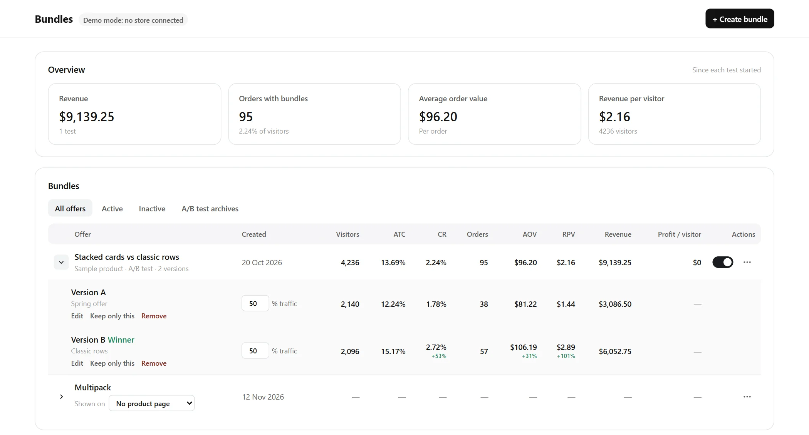
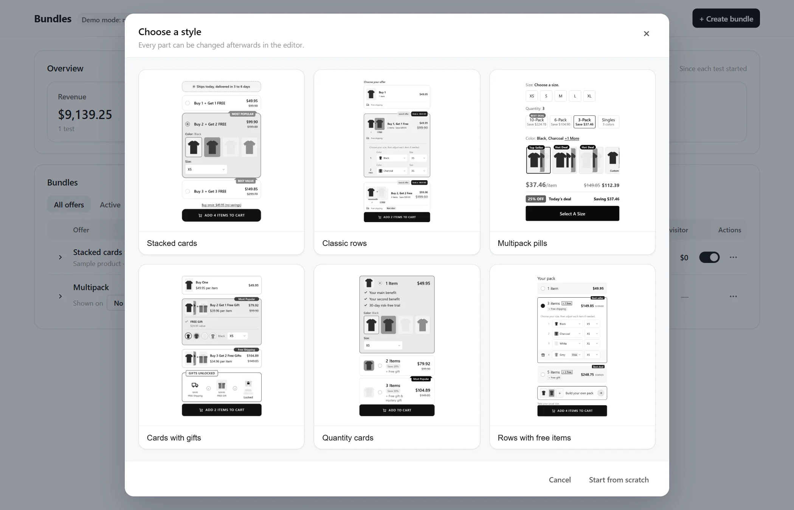
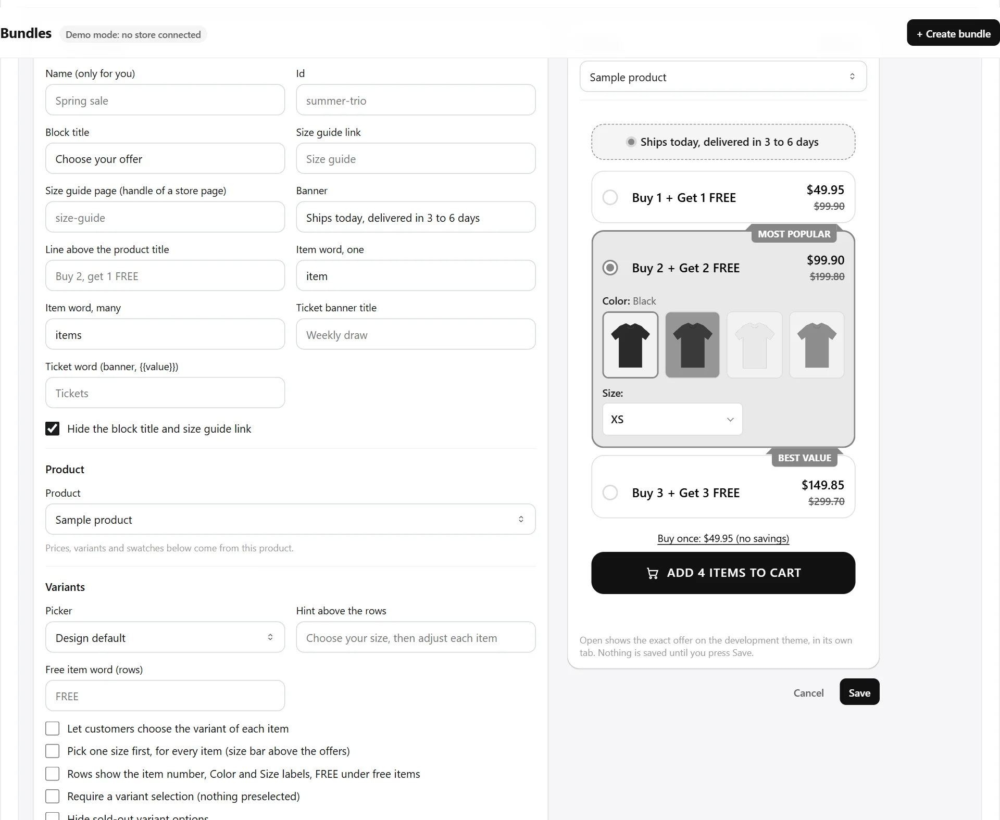

# Open Bundles

Homemade bundle offers ("Buy 2, get 1 free", multipacks, free gifts) for Shopify product pages, with A/B tests.
No monthly app: a local editor, a few theme snippets and one discount function.



What you get:

- **Editor** (runs on your computer): create bundles from 6 starting styles, change every text, colour and spacing, live preview.
- **Theme snippets**: draw the offer block on the product page, with its own variant pickers and Add to cart button.
- **Discount function**: charges exactly the price the block shows (bars, free items, gifts, free shipping).
- **A/B tests**: split traffic between 2 to 4 bundles, read orders, revenue, AOV per version and pick a winner.

Only the offer block is in scope: no landing pages, no pop-ups.

> **Using an AI assistant?** Give it this repository link and say what you want, for example
> "install this on my store" or "make a bundle that looks like the one on https://some-store.com/products/x".
> The section [For AI assistants](#for-ai-assistants) tells it how.

## How I use it

1. I find a store whose bundle block I like.
2. I give the product page URL to Claude: *"Recreate the bundle on https://some-store.com/products/x as a new style in Open Bundles."*
3. The AI reads the page, copies the layout and texts into a bundle (or a new starting style), checks it in the editor preview.
4. I tweak it in the editor, put it on my product page, and run it in an A/B test against my current offer.





## Try it (2 minutes, no store needed)

```bash
pip install -r editor/requirements.txt
python editor/server.py
```

Open http://127.0.0.1:8787. Until you connect a store the editor runs in **demo mode**: a sample product, nothing sent anywhere.

## Install on your store

You need Python 3.10+, Node 20+ and the [Shopify CLI](https://shopify.dev/docs/api/shopify-cli). The CLI signs you in
to your Shopify account in the browser the first time you run it: you log in yourself, nothing to paste anywhere.

### 1. Create the app and deploy the discount function

```bash
shopify app init          # sign in, then choose "Build an extension-only app"
```

Copy the `function/` folder of this repository into the new app as `extensions/open-bundles/`, then in the app's
`shopify.app.toml` set the scopes:

```toml
[access_scopes]
scopes = "read_products,read_orders,read_files,write_discounts"
```

```bash
shopify app deploy
```

Install the app on your store (link shown in the Dev Dashboard).

### 2. Connect the editor

Run `python editor/server.py`, open http://127.0.0.1:8787 and click **Connect to store**. Type your store's
myshopify.com domain and your app's client ID and secret (Dev Dashboard > your app > Settings), or an Admin API token,
then **Connect**: the editor tests the keys and lists any missing app scope.


The keys stay on your computer, in `~/.open-bundles/settings.json` (outside the project folder, so they never end up
in git), and the editor never shows them again. Type them yourself: you never have to give them to anyone, AI
assistants included.

Then click **Create the bundle discount** in the same window, once.

### 3. Add the block to your theme

Copy `theme/snippets/*` and `theme/assets/ob-bundle.js` into your theme, then render the block where the product form is
(main product section):

```liquid

```

The block brings its own variant pickers and Add to cart button. On products that have a bundle, hide the theme's ones:

```liquid

 ...your theme's variant picker and buy buttons... 
```

Test on an unpublished copy of your theme first (put its ID under "Preview links" in the Connect to store window so the editor's "Open" links use it).

### 4. Make a bundle

`python editor/server.py`, **+ Create bundle**, pick a style, choose the product, edit, **Save**, then pick the product
page under "Shown on". Changes go live at once (they are stored in a shop metafield, no theme push).

## A/B tests

In the list, open a bundle's **⋯** menu and choose **Start an A/B test**: version A is the current offer, version B
starts as a copy you then edit (add C and D the same way), and the switch turns the test on. Each visitor
keeps one version. Orders carry it (cart attribute `_obab`), so the editor reads orders, revenue, AOV and units per version
straight from Shopify. A winner is called with a z-test once every version has at least 10 orders.

Useful URLs on a product page:

- `?ab=<test id>:b` forces version B (never counted).
- `?ob=<bundle id>` previews a bundle without assigning it.

### Visitors and add to carts (optional)

Conversion rate needs visitor counts, which Shopify does not give per version. The theme can send them to a small
collector you host. A reference one is in `stats/collector.py` (Python standard library + SQLite, one file):

```bash
READ_KEY=choose-a-secret python stats/collector.py 8790
```

Host it anywhere that suits you, reachable over HTTPS: a small server or VPS behind a reverse proxy, a container
platform, or rewrite its two endpoints on any serverless platform and database you like. Then put its URL and read key
under "A/B stats collector" in the Connect to store window.

The contract (all you need to reimplement it):

| Call | Body / answer |
|---|---|
| `POST /` (sent by the theme with `sendBeacon`) | `{"vid": "abc123", "e": "view" or "atc", "t": [["<test>", "a"]], "p": "/products/x"}`, answer 204 |
| `GET /stats?test=<test>` with `Authorization: Bearer <read key>` | `{"versions": {"a": {"visitors": 120, "atc": 18}, "b": {...}}}` (unique visitors) |

Without a collector everything works; the results show orders and revenue only.

## Repository map

| Path | What |
|---|---|
| `editor/server.py` | Local editor server (127.0.0.1:8787) and JSON API |
| `editor/bundles.py` | Bundle validation (`_clean_bundle`: every field a bundle can have), publishing to the metafield `open_bundles.config` |
| `editor/tests.py` | A/B tests and results |
| `editor/render.py` | Draws the preview with the theme's own snippets (python-liquid) |
| `editor/app/` | Editor page (plain JS modules, no build) |
| `theme/` | Storefront snippets (`ob-offer` is the entry) and `ob-bundle.js` |
| `function/` | Discount function (JS), tests: `npm install && npx vitest run` |
| `data/templates.json` | Starting styles of "Choose a style" |
| `data/bundles.json`, `data/tests.json` | Your bundles and tests (created on first save) |
| `scripts/capture_looks.py` | Redraws the style thumbnails in `media/looks/` |
| `stats/collector.py` | Optional visitor counter |

## For AI assistants

Read this section before changing anything.

**Keys are off limits.** Never ask the user for their app secret, token or stats key, never read, print or edit
`~/.open-bundles/` or any file holding them, and never put keys in commands or files. The user types them in the
editor's **Connect to store** window themselves. The Shopify CLI login (`shopify app init`, `shopify app deploy`) also
happens in the user's browser: run the command and let them sign in.

**Installing for a user:** follow "Install on your store" step by step. Running the CLI steps and copying the theme
files is your part; signing in and the Connect window are theirs. Test theme changes on an unpublished theme; publish
nothing live without the user's yes.

**Recreating a bundle from a URL:**

1. Open the page and study the offer block only: bars or cards, labels, badges, prices and strikethroughs, free items,
   gifts, variant pickers, button text, colours, corner radius, spacing, font sizes. Take screenshots.
2. Express it as a bundle object. Every accepted field and its limits are in `_clean_bundle` in `editor/bundles.py`;
   the 6 entries of `data/templates.json` are complete working examples (closest one first). Designs: `classic` (rows),
   `cards`, `boxed`, `pack`; `style` holds colours (hex) and sizes (numbers).
3. Either add it to `data/templates.json` as a new style (then run `PW_CHANNEL=msedge python scripts/capture_looks.py`
   with the editor running, for its thumbnail), or save it as a bundle through the editor (`POST /api/bundles/<id>`
   with header `X-editor: 1`).
4. Check it: open the editor, pick it, compare the preview with your screenshots side by side, fix the gaps. Copy the
   layout and sizes, use the user's own products, prices and wording, and never other stores' images or brand names.
5. If the look needs something the fields cannot express, extend `theme/snippets/ob-bundle-*.liquid` and
   `_clean_bundle` together, keep the editor fields (`editor/app/bundle-editor/`) in sync, and run the function tests.

**Prices:** the discount function charges from the same config the block reads; after touching pricing logic run
`npx vitest run` in `function/`.

## License

MIT
